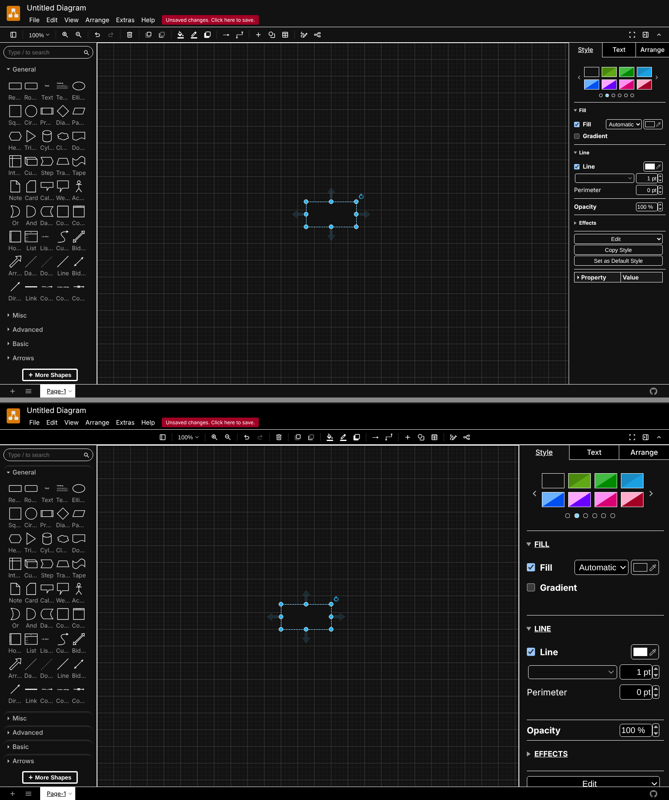
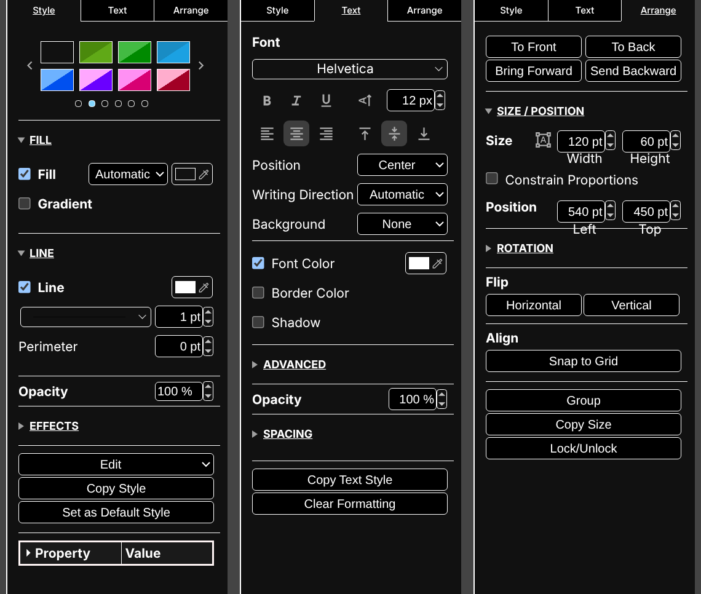
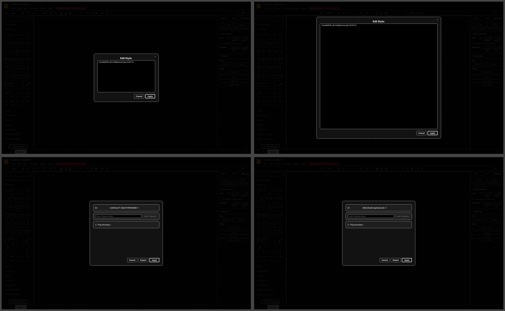

# draw.io Desktop: Roomy Dark Theme

A custom CSS theme for [draw.io Desktop](https://github.com/jgraph/drawio-desktop) that makes the editor easier on the eyes and less crowded:

- **Wider, roomier Format panel.** The right-hand panel goes from 240px to 360px. Its contents are scaled to match, with extra space between rows and sections.
- **True-black panels** with a grey pasteboard, so the page stands out.
- **Clearer section headers**, black buttons and inputs, and a bordered style-properties table.
- **Centered toolbar.**
- **Bigger text-editing dialogs.** Edit Style, Edit Diagram and Configuration open large and centered.

It only uses draw.io's own class names (no `nth-child` paths or tooltip text), so it keeps working in any language and should survive app updates.



| Format panel: Style, Text and Arrange tabs | Text-editing dialogs, before and after |
|---|---|
|  |  |

Tested on **draw.io Desktop 32.6.1** (macOS) in dark mode.

## Install

1. In draw.io, open **Extras > Configuration**.
2. Add a `"css"` key to the JSON. Its value is the whole stylesheet as one string. You don't need to escape it by hand: copy the ready-made value from [`css-value.txt`](css-value.txt).

   ```json
   {
     "css": "PASTE THE CONTENTS OF css-value.txt HERE (it already includes the quotes)",
     "...": "your other settings stay as they are"
   }
   ```

   If your configuration is empty, it's simply `{ "css": <contents of css-value.txt> }`.
3. Click **Apply**. draw.io restarts with the theme.

To remove it, delete the `"css"` key and click Apply again.

## Customize

The stylesheet is split into numbered sections ([`drawio-custom.css`](drawio-custom.css)), and each one has comments. Edit the `.css` file, then turn it back into a JSON string. One way to do that in Terminal:

```sh
python3 -c 'import json,sys; print(json.dumps(open(sys.argv[1]).read()))' drawio-custom.css > css-value.txt
```

**Changing the Format panel width:** keep `zoom = width ÷ 240`. For example, use `300px` with `zoom: 1.25`, or `360px` with `zoom: 1.5`. draw.io places the panel's controls at fixed pixel positions. That's why the theme scales the contents instead of adding padding, which would make them overlap.

**Making the whole UI bigger:** use the app's own zoom (draw.io menu > Zoom In, or launch with `--zoom 1.25`) rather than raising font sizes.

## Known draw.io issue: tool windows don't reopen at launch

In 32.6.1, draw.io saves the Layers, Outline and Tags windows. But at startup it hides them again while it waits for a file to open, and saves them as closed. Their position and docking are kept, so after a file opens these shortcuts bring each window back exactly where you left it:

| Window | macOS | Windows / Linux |
|---|---|---|
| Layers | ⌘⇧L | Ctrl+Shift+L |
| Outline | ⌘⇧O | Ctrl+Shift+O |
| Tags | ⌘K | Ctrl+K |

If you use the wider panel, re-dock any windows that sat beside the old one once.

## Credits

Created by [EXP LAB] (The Experience Lab), with the investigation, CSS and testing done together with Claude, Anthropic's AI assistant.

## License

[MIT](LICENSE)
